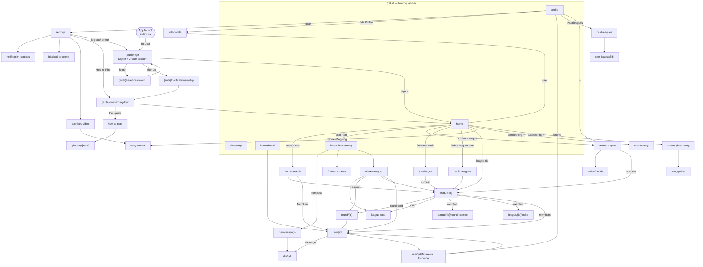

# Riff — App Architecture Map

React Native / Expo app using Expo Router, with file-based routes under `frontend/app/`. Everything below comes from reading the current source. Line references are approximate.

- [1. Design System](#1-design-system)
- [2. Master Screen Inventory](#2-master-screen-inventory-sitemap)
- [3. Step-by-Step User Flows](#3-step-by-step-user-flows)
- [4. Screen-by-Screen Specs](#4-screen-by-screen-specs)
- [Appendix: Inconsistencies & Dead Code Found](#appendix-inconsistencies--dead-code-found)

---

## 1. Design System

The tokens live in `frontend/src/theme/` (`colors.ts`, `font.ts`, `spacing.ts`). `index.ts` re-exports all three. The app uses a **light theme**, and the root `StatusBar` is set to `dark`.

> **Adoption note:** screens import `colors` widely. No screen imports `fontSize`, `fontWeight` or `spacing`: font sizes, padding and radii are all inline numeric literals. Several surfaces still hardcode hex: Home, StoriesRing, the story screens, CreateJoinSheet, LeagueAvatar, Skeleton and the legacy `(tabs)/join`.

### 1.1 Color tokens (`colors.ts`)

| Group | Token | Value | Typical use |
|---|---|---|---|
| Background | `bg` | `#FFFFFF` | Screen background, sheets, round/sub cards |
| Surfaces | `surface` | `#F7F7F7` | Form cards (create-league, NotifPrefsList), theme cards |
| | `surface2` | `#F2F2F2` | Grouped list cards (Settings), round cards/banners, podium, list rows |
| | `surface3` | `#E8E8E8` | Inputs (auth), inactive tabs/pills, chips, avatar fallbacks, modals |
| | `surface4` | `#E0E0E0` | Search fields in modals, "Cancel" buttons, deeper avatar fallback |
| Text | `textPrimary` | `#000000` | Headings, body |
| | `textSecondary` | `#666666` | Subtitles, meta, icons in rows |
| | `textTertiary` | `#999999` | Captions, timestamps, section labels, chevrons |
| | `textPlaceholder` | `#999999` | TextInput placeholders |
| Borders | `border` | `rgba(0,0,0,0.10)` | Hairlines, header dividers, top-bar circle buttons |
| | `borderStrong` | `rgba(0,0,0,0.20)` | Outline buttons (secondary Follow, Decline), filled inputs |
| | `borderFaint` | `rgba(0,0,0,0.05)` | List separators, tab-bar pill border, result bars |
| Accent | `accent` | `#7C3AED` | Primary CTAs, active tabs/chips, badges, spinners, wordmark |
| | `accentFaint` | `rgba(124,58,237,0.15)` | Selected states, "YOU" rows/badges, status pills |
| Status | `success` | `#10B981` | Username "Available", up-deltas, "✓ Invited" |
| | `warning` | `#F59E0B` | Password strength (medium) |
| | `danger` | `#EF4444` | Destructive rows, unread badges, report reasons, errors |
| On-color | `onAccent` | `#FFFFFF` | Text/icons on accent or danger fills |
| | `onMedia` | `#FFFFFF` | Text over cover images |
| | `onMediaDim` | `rgba(255,255,255,0.85)` | Secondary text over images |
| Avatars | `avatarPalette` | `#7C3AED` `#10B981` `#F59E0B` `#EF4444` `#3B82F6` `#EC4899` `#14B8A6` `#F97316` | Hash-picked initials backgrounds (league/[id]) |
| Brand | `spotify` | `#1DB954` | Spotify service buttons |
| | `appleMusic` | `#FA243C` | Apple Music buttons (Discovery hardcodes `#FC3C44` instead) |
| | `explicitRed` | `#FF0000` | Used as the YouTube button color |
| Overlays | `scrim` | `rgba(0,0,0,0.6)` | ReportReasonSheet, SongDetailSheet, leaderboard menu |
| | `scrimLight` | `rgba(0,0,0,0.55)` | Create-league member-cap picker |
| Nav | `navBar` | `#1a1a1a` | Defined but unused by the current tab bar |
| | `navBarText` | `#FFFFFF` | Defined but unused |

**Recurring hardcoded colors that are not tokens:**
- `#7C5CFF` / `rgba(124,92,255,0.14)`: Home progress bars, past-league "you" rows.
- `#22C55E`: "done/live" green in league/[id].
- `#C7C7CC` / `#D8D8DC`: podium.
- `#D97706` / `#F5D48A`: forfeit banner.
- `#F5A524`: WINNER label.
- `rgba(0,0,0,0.8–0.95)`: modal overlays.
- Inbox category colors: `#3B82F6` `#F59E0B` `#EF4444` `#10B981` `#6B7280`.
- Story screens use a dark palette: `#000`, `#0a0a0a`, `#121212`, `#1E1E1E`, `#282828`, `#2A2A2A`, `#3A3A3A`, `#B3B3B3`, `#FF3B30`.

### 1.2 Typography (`font.ts`)

| `fontSize` token | px | Observed usage |
|---|---|---|
| `micro` | 11 | Kicker/section labels (uppercase, 700–800, letterSpacing 1–2.5), status pills |
| `small` | 13 | Meta lines, captions, small buttons |
| `body` | 15 | Body, inputs, list titles |
| `title` | 17 | Centered screen header titles ("Search", "Add Music", "Invite users") |
| `h3` | 20 | Song titles in heroes |
| `h2` | 24 | Cover titles, OTP digits |
| `h1` | 32 | How-to-play hero |

| `fontWeight` token | value |
|---|---|
| `regular` | 400 |
| `medium` | 500 |
| `semibold` | 600 |
| `bold` | 700 |
| `extrabold` | 800 |

The code uses some sizes outside the scale: 12, 12.5, 13.5, 14 (the most common button/body size), 16, 18, 22, 26, 28, 30 (tab-screen titles like "Leaderboard" and "Inbox") and 44 (login brand, glossary title). Weight 900 is also used for heroes.

There are no custom fonts; everything uses the system font. The only `fontFamily` overrides are monospace, for join codes (`Menlo`/`monospace`) and the photo-story eyebrow (`Courier`).

Two recurring patterns:
- **Uppercase screen labels:** 13/800 with letterSpacing 1.4, e.g. "SETTINGS", "CREATE LEAGUE", "HOW TO PLAY".
- **Display headlines:** 26–28/800, e.g. "PAST LEAGUES", "JOIN A LEAGUE".

### 1.3 Spacing (`spacing.ts`)

| Token | `xs` | `sm` | `md` | `lg` | `xl` | `xxl` | `xxxl` |
|---|---|---|---|---|---|---|---|
| px | 4 | 8 | 12 | 16 | 20 | 24 | 32 |

Screens use the same values inline:
- 20px horizontal page padding on Home, create-league and edit-profile.
- 24px on auth screens and notification-settings.
- 16px header padding.

### 1.4 Border radius (no token file — observed values)

| Radius | Role |
|---|---|
| **999** (also 50) | Pills: primary/secondary buttons, chips, segmented tabs, status pills, Follow/Invite/Join pills, story rings |
| **28–29** | Full-width 56–58px primary CTAs (auth, onboarding, create-league, round-themes) |
| **24** | League cover cards, Home CTAs (48h), share sheet/card, story Post button |
| **20–22** | Large cards: create-league setting cards, round winner hero, SongDetailSheet, "Your final place" box, ExpandableImage |
| **16–18** | Auth inputs (16), create-league inputs (18), round/submission cards & overflow popover (16), Home league tile & NotifPrefsList cards (18), chat bubbles (16, tail 4) |
| **12–14** | Standard cards/rows: Settings groups (12), inbox rows (12), search result rows (14), ReportReasonSheet groups (14), past-league rows (14) |
| **8–10** | Inputs & search bars (10), small cards, banners, thumbnails, service buttons (8) |
| **4–6** | Badges (YOU / LEFT / Creator: 4), small album art (6), progress bars (2–4) |
| **size/2** | Every avatar: 32→16, 44→22, 64→32, 88→44, 120→60 |

By count across the codebase, the most common values are 8 (61 uses), 12 (47), 999 (41), 14 (41), 16 (25) and 20 (24).

### 1.5 Global shell

**Root stack** (`app/_layout.tsx`):
- Provider order: `GestureHandlerRootView` → `SafeAreaProvider` → `AuthProvider` → `InboxDataProvider` → `Stack`.
- `headerShown: false` everywhere, with `contentStyle.backgroundColor = colors.bg`.
- Default `animation: 'none'`. Most pushed screens use `slide_from_right`; `story-viewer` uses `fade` (150ms).
- Every screen draws its own header.

**Entry** (`app/index.tsx`): waits for `AuthContext.isLoading`, then calls `router.replace` to `/(tabs)/home` if signed in, otherwise `/(auth)/login`.

**Bottom floating tab bar** (`app/(tabs)/_layout.tsx`):

- **Construction:** a custom `FloatingTabBar` sits absolutely positioned at `bottom: insets.bottom + 12`. It is centered with no container background; each tab floats independently with a 6px gap.
- **"Liquid glass" tab:**
  - Each `TabButton` is a 44px circle with a `BlurView` (intensity 28, light), a 1px `borderFaint` border and a drop shadow (0.12 opacity, radius 10, elevation 8).
  - When active it animates (200ms ease-out) into a pill. A solid `colors.bg` layer fades in, and the label reveals at 13.5/700 in `textPrimary`.
  - Inactive icon color is `textTertiary`. Press scales the tab to 0.94.
- **Visible tabs:**

  | Route | Ionicon | Label |
  |---|---|---|
  | `home` | `home-outline` | Home |
  | `discovery` | `headset-outline` | Discover |
  | `leaderboard` | `trophy-outline` | Leaderboard |
  | `profile` | `person-outline` | Profile |

- **Hidden tab routes:**
  - `inbox` is registered but excluded from the pill, because the chat icon moved to the Home header.
  - `add` and `join` use `href: null`. `add` renders an empty `View`; `join` is a legacy join screen.
- **Unread badge:** the badge logic (`danger` circle) is keyed to `inbox`, so it never renders in the pill now. The unread count shows on the Home header instead.
- **Clearance:** `FLOATING_NAV_CLEARANCE = 150` is exported for bottom padding on tab screens.

**Home header icons** (`app/(tabs)/home.tsx`, `headerRow`):

| Position | Element | Action |
|---|---|---|
| Left | "Riff" wordmark (26/800, `#7C3AED`), not tappable | — |
| Right 1 | `search` Ionicon 24 (44×44 hit area) | `router.push('/home-search')` |
| Right 2 | `chatbubble-outline` Ionicon 24, with a red `colors.danger` badge (16px, count or "99+") when `useInboxData().totalUnread > 0` | `router.push('/inbox')` |

There is no "+" button in the header. Create and join live in the CTA row below it: "+ Create league" and "Join with code". Adding a story is the "+" badge on the StoriesRing "Today's Vibe" tile. Settings is reached from the Profile tab's gear icon.

---

## 2. Master Screen Inventory (sitemap)

```
app/
├── _layout.tsx                      Root Stack + providers
├── index.tsx                        Auth gate → /(tabs)/home | /(auth)/login
│
├── (auth)/                          Stack, no headers
│   ├── login.tsx                    Sign in + Create account (segmented)
│   │     • Alert.alert errors
│   │     • Legal microcopy "Terms / Privacy Policy" (plain text, NOT linked)
│   ├── register.tsx                 Redirect → /(auth)/login (legacy)
│   ├── reset-password.tsx           3-step: email → 6-digit code → new password
│   │     • Alert.alert (code sent / invalid / reset)
│   ├── notifications-setup.tsx      Post-signup notif prefs (NotifPrefsList)
│   │     • OS push-permission prompt
│   └── onboarding-tour.tsx          4-page swipe intro (also ?mode=replay)
│
├── (tabs)/                          Custom FloatingTabBar
│   ├── home.tsx                     Dashboard: header, CTAs, StoriesRing, league grid
│   │     • StoriesRing add-story action sheet (Add Music / Add Music + Photo)
│   │     • League image zoom Modal (long-press tile)
│   │     • CreateJoinSheet (mounted but never opened)
│   ├── discovery.tsx                Vertical song-preview feed + genre chips + inline search
│   ├── leaderboard.tsx              All-time leaderboard
│   │     • Scope picker Modal (All Members / Following / Friends)
│   ├── profile.tsx                  My profile: counts, Stats/Liked tabs
│   │     • ExpandableImage avatar Modal
│   │     • SongDetailSheet (LikedSongsTab)
│   ├── inbox.tsx   (hidden tab)     Categories + Follow Requests row + DM list
│   │     • Swipe-to-hide DM (Swipeable trash)
│   ├── add.tsx     (hidden, empty)
│   └── join.tsx    (hidden, legacy) Old single-field join by code
│         • Alert.alert success/error
│
├── league/
│   ├── [id].tsx                     League hub: Rounds | Standings | Submissions
│   │     • Overflow popover: JOIN CODE (copy) · Edit league image · Edit round themes
│   │       · Invite users · Delete league / End League Early | Leave league
│   │     • Members Modal
│   │     • ShareResultsModal (variant 'standings')
│   │     • Alerts: Delete / End early / Leave / Advance Round / Start first round
│   │       / Round locked / Round starts automatically
│   │     • ImagePicker (edit league image)
│   │     • "Start New Round" Modal (dead code, never opened)
│   └── [id]/
│       ├── round-themes.tsx         Commissioner: edit themes of non-completed rounds
│       └── invite.tsx               Commissioner: search & invite users (pre-start)
│
├── round/[id].tsx                   Round lifecycle: submission → voting → completed
│     • Song Selection Modal (search + submit)
│     • Missing Submissions bottom sheet (grant 2-hr extension, creator)
│     • Expand Results "Results Grid" Modal
│     • ShareResultsModal (variant 'round')
│     • ReportReasonSheet (targetType 'submission', long-press a song)
│     • ConfettiCannon (results)
│     • Alerts: Lock submission / Lock vote / Incomplete / Reopen / Voting locked
│
├── past-leagues.tsx                 Archived leagues list, search, swipe-to-delete
│     • Delete confirm Modal · "About past leagues" Alert
├── past-league/[id].tsx             Archive: Standings | Songs you submitted
│     • Members Modal · "League ended early" Alert
│
├── create-league.tsx                3-step wizard → LeagueCreatedSuccess
│     • Discard Alert · Photo ActionSheetIOS / Alert · "Max members" picker Modal
│     • LeagueCreatedSuccess (code + COPY CODE / public auto-start message)
├── invite-friends.tsx               Friend multi-picker for create-league
├── join-league.tsx                  6-box OTP join by code (inline error box)
├── public-leagues.tsx               Browse/join public leagues
│
├── user/
│   ├── [id].tsx                     Other user's profile
│   │     • Overflow (ActionSheetIOS / Alert): Unfollow | Cancel request · Remove follower
│   │       · Block @x · Report @x · Cancel
│   │     • ReportReasonSheet (targetType 'user') → "also block?" Alert
│   │     • Block / Unfollow / Remove follower confirms · ExpandableImage · SongDetailSheet
│   └── [id]/
│       ├── followers.tsx            → FollowListScreen mode="followers"
│       └── following.tsx            → FollowListScreen mode="following"
│             • Unfollow / Cancel request Alerts · ExpandableImage
│
├── inbox-category.tsx               Items for one inbox category; select & delete;
│                                    Follow back; Accept/Decline league invites
├── follow-requests.tsx              Accept / Decline requests
├── dm/[id].tsx                      1:1 chat (friends only)
│     • ReportReasonSheet (targetType 'message', long-press their bubble)
│     • "Not friends yet" Alert
├── new-message.tsx                  Pick a friend → start DM
├── league-chat.tsx                  League group chat (?leagueId&leagueName)
│     • ReportReasonSheet (targetType 'message')
│
├── create-story.tsx                 Song-only story: SongList → dark composer
├── create-photo-story.tsx           Photo + draggable song sticker story
│     • ImagePicker camera/library · → /song-picker
├── song-picker.tsx                  "Add Music" SongList (used by photo story only)
├── story-viewer.tsx                 Full-screen story playback
│     • Overflow sheet: Delete Story (own) | Report Story (others)
│     • "Delete this story?" Alert · ReportReasonSheet (targetType 'story')
├── archived-vibes.tsx               3-col grid of expired own stories
│
├── home-search.tsx                  Leagues | Members search tabs
│     • Alert.prompt for private-league code (LeaguesSearchTab)
├── settings.tsx                     Account hub
│     • Change-photo ActionSheetIOS / Alert · "Edit username" Modal
│     • "Clear account data?" Modal · "Delete your account?" Modal · "Data cleared" Modal
│     • Log out Alert · Legal links (Linking.openURL):
│         https://www.theriffapp.com/#terms-of-service
│         https://www.theriffapp.com/#privacy-policy
├── edit-profile.tsx                 Photo, name, username, pronouns, bio
│     • Photo ActionSheetIOS (incl. Remove Photo)
├── notification-settings.tsx        NotifPrefsList
├── blocked-accounts.tsx             List + bulk unblock (select mode)
│     • Unblock / Unblock selected Alerts
├── how-to-play.tsx                  Static guide → glossary links
└── glossary/[term].tsx              Terms: submission, voting
```

**Shared overlay components** (`frontend/src/components/`):

| Component | What it is | Used by |
|---|---|---|
| `ReportReasonSheet` | Bottom-sheet Modal. Reasons: Spam, Harassment or bullying, Hate speech or symbols, Nudity or sexual content, Other (shown in `danger` text). Has a Cancel group. Calls `reportContent`, then the "Thanks for reporting" alert. | user/[id] (user), story-viewer (story), dm/[id] and league-chat (message), round/[id] (submission) |
| `ShareResultsModal` | Bottom sheet with a `ViewShot` `ResultCard` (300w, `#7C3AED`, radius 24) and three actions: Save image (MediaLibrary), Copy link (Clipboard), More (`Sharing.shareAsync`). | round/[id], league/[id] |
| `ExpandableImage` | Long-press opens a full-screen image Modal (`rgba(0,0,0,0.95)`). | profile, user/[id], settings, edit-profile, FollowListScreen |
| `CreateJoinSheet` | Dark bottom sheet with Create League / Join League. | home (mounted, never opened) |
| `LeagueCreatedSuccess` | Post-create success screen. | create-league |
| `SongList` | Song search plus "New This Week" / "Liked Songs" chips. | song-picker, create-story |
| `StoriesRing` | Story avatars plus the add-story sheet. | home |
| `NotifPrefsList` | Notification toggles. | notifications-setup, notification-settings |

---

## 3. Step-by-Step User Flows

### (a) Sign up → onboarding → home
1. On launch, `app/index.tsx` runs `AuthContext.loadStoredAuth`. It reads `token`/`user` from AsyncStorage and validates them with `GET /api/auth/me`. With no user it goes to `router.replace('/(auth)/login')`.
2. On `/(auth)/login` the user taps the **"Create account"** segment (`mode='signup'`).
3. They fill in **Name, Email, Username, Password and Confirm password**.
   - The username is checked live with `checkUsername`: 300ms debounce, at least 3 characters, then "Available" or "Taken".
   - Below the password, a 4-segment strength meter is shown.
   - Microcopy notes agreement to the Terms and Privacy Policy (not linked).
4. Validation requires every field, matching passwords and a password of at least 6 characters.
5. `register()` posts to `/api/auth/register`, stores the token and user, and refreshes the push token. The backend also creates a "Welcome to Riff" system notification.
6. Then `router.replace('/(auth)/notifications-setup')`. The user toggles prefs in `NotifPrefsList` and taps **Continue**, which shows the OS push prompt through `registerForPushNotifications()`, or **Maybe later**.
7. `router.push('/(auth)/onboarding-tour')` shows 4 pages: "Settle who has the best *taste.*", "Submit, then *vote.*", "More than a *league.*" and "Climb the *leaderboard.*". The user swipes through or taps **Skip**.
8. **Start playing** sets AsyncStorage `onboarding_complete='true'` and calls `router.replace('/(tabs)/home')`.
- **Returning sign-in:** "Sign in" mode → `login()` → `router.replace('/(tabs)/home')`, skipping onboarding.
- **Forgot password:** `/(auth)/reset-password`. Steps: email → 6-digit code → new password. It then returns to login with the email prefilled.
- **Replay:** Settings → How to Play → `/(auth)/onboarding-tour?mode=replay`. Finishing calls `router.back()`.

### (b) Create a league → rounds/themes → invite
1. On Home, tap **"+ Create league"** (or the Profile tab's `add` icon) to open `/create-league`.
2. **Step 1, "Set up your league" (Basics):**
   - Optional photo (camera or library).
   - **League name**, required, max 60.
   - **Genre**, optional (required if public), max 50.
   - **Cadence:**
     - Number of Rounds chips, 2–10 (default 3).
     - Submission Time, 12h/1d/2d/3d/7d (default 48h).
     - Voting Time, same choices (default 72h).
   - **Options:**
     - "Rounds will have themes" (default on).
     - "Public league". When on, it adds "Start first round in" (1h/12h/1d/3d/7d) and "Max members" (10–100, default 50).
   - **"Invite people you know":** the top 5 co-members can be toggled, and **Invite friends** opens `/invite-friends`, a multi-select. The selection comes back via `pendingInvitees`.
3. **Step 2, "Name your rounds" (Themes; skipped if themes are off):** one theme card per round. Every theme is required before **Review**.
4. **Step 3, "Review & create":** a preview card, a settings summary and the round themes. Tapping any row jumps back to its step.
5. **Create league** calls `createLeague({...})`. Rounds are generated from `total_rounds` plus `themes[]`; they are not added one by one.
   - If invitees were chosen, `inviteUsersToLeague` runs in the background.
6. **`LeagueCreatedSuccess`** follows:
   - **Private** leagues show the 6-character code with a **COPY CODE** button.
   - **Public** leagues show "Round 1 will start automatically…".
   - **Go to my league** → `router.replace('/league/{id}')`.
7. **Later, from the league hub overflow menu (creator only):**
   - **Edit round themes** → `/league/{id}/round-themes`.
   - **Invite users** → `/league/{id}/invite`. Available before any round starts; search by username, then **+ Invite**.
   - **JOIN CODE** row → copy. Private leagues, before the start only.
   - **Start Round** on a `ready` round. Round 1 asks for confirmation: "Once the first round begins, no new members can join…".

### (c) Join a league
**By code:**
1. On Home, tap **"Join with code"** → `/join-league`.
2. Type or paste into the 6 OTP boxes. Input is uppercased and limited to `[A-Z0-9]`; a paste is spread across the boxes.
3. **JOIN LEAGUE** stays disabled until all 6 are filled. It calls `joinLeague(code)` (`POST /leagues/join`).
4. On success: `router.replace('/league/{id}')`. Errors appear in an inline box:
   - 404: no match.
   - 403: block.
   - 400: already a member.
   - Network failure.

**Public:**
1. On Home, the footer card **"Public leagues"** → `/public-leagues`. Search is server-side with a 300ms debounce, and the "Starts in" countdown is live.
2. **Join League** calls `joinPublicLeague(id)`. The row flips to **Joined** optimistically, and tapping a joined row → `/league/{id}`.
3. **Alternatives:**
   - Search: `/home-search` → Leagues tab. It has the same join logic; private leagues prompt for the code with `Alert.prompt`.
   - Opening a public `/league/{id}` as a non-member shows a **Join League** CTA.
4. **Deep links:** `handleShareLeagueCode` builds `musicleague://join/{code}`, but there is no `/join/[code]` route, so these links are not handled (see Appendix).

### (d) Submit → vote → results / standings
1. Home league tile → `/league/{id}` → **Rounds** tab → a live round card → `/round/{roundId}`.
2. **Submission phase** (`status === 'submission'`):
   - The header shows a status pill, the "Submission ends in" countdown and an "x/y submitted" count.
   - **Submit Your Song** opens the in-screen **Song Selection Modal**: search (at least 2 characters, 500ms debounce), with preview and service links on each result.
   - Tapping a result submits it right away with `submitSong(id, song, false)`.
   - **Change Song** reopens the modal. **Lock It In** shows a confirm Alert, then `submitSong(..., true)`, which is permanent.
   - Other people's songs stay hidden; only a count is shown.
3. **Voting phase** (`status === 'voting'`):
   - The list excludes your own song.
   - Each song gets a unique rank (1…N) from a dropdown. Picking a rank another song already holds swaps the two.
   - **Save Vote** requires every song to be ranked and calls `submitVote(id, rankings, false)`.
   - The "Vote saved!" banner offers **Change Vote** or **Lock It In** (confirm, then `submitVote(..., true)`).
   - Non-submitters see a forfeit banner, and their controls are disabled.
   - The creator can **Reopen Submissions** for missing members, granting a 2-hour extension.
   - Points are computed on the backend from the ranks.
4. **Advance:** rounds advance on their timers. The commissioner can also tap **Advance to Voting/Results** on the league hub.
5. **Results** (`status === 'completed'`):
   - Confetti.
   - The **Round Winner** hero, which is tie-aware.
   - **FULL RESULTS**, with animated point bars and your own row highlighted.
   - A **NO SUBMISSION** list for members who didn't submit.
   - **Share Results** opens `ShareResultsModal`. **Expand Results** opens the Results Grid of who ranked what where.
   - Long-pressing a song opens the Report sheet.
6. **Standings:**
   - **League:** `/league/{id}` → **Standings** tab shows a podium, the ranked list with rank deltas, and Share.
   - **Archive:** Profile → Stats → Past leagues → `/past-leagues` → `/past-league/{id}`.
   - **Global:** the **Leaderboard** tab.

### (e) Social: follow → chat/DM → report/block
1. **Find a user:** Home search → `/home-search` → **Members** tab → `/user/{id}`. Users are also reachable from:
   - follower and following lists,
   - top voters,
   - round winners,
   - inbox follow notifications,
   - story avatars.
2. **Follow:** tap **Follow** (or **Follow back**).
   - A public account becomes **Following**, or **Friends** if they already follow you.
   - A private account becomes **Requested**. The profile shows a lock box until the request is approved.
   - The other user approves in Inbox → **Follow Requests** → `/follow-requests` (Accept / Decline).
3. **DM (mutual follows only):**
   - From a profile, **Message** → `startConversation` → `/dm/{id}`.
   - From the Inbox, the compose icon → `/new-message` → pick a friend → `/dm/{id}`.
   - Non-friends get the "Not friends yet" alert, and the composer is disabled.
4. **League chat:** the league hub chat icon (members only, with an unread dot) or Inbox → League activity → `/league-chat?leagueId&leagueName`. It polls every 3s.
5. **Report:**
   - **A user:** profile ⋯ → **Report @x** → `ReportReasonSheet` → "Thanks for reporting… You can also block this user" → optional **Block**.
   - **A message:** long-press another person's bubble in a DM or league chat.
   - **A submission:** long-press a song in a round.
   - **A story:** story viewer ⋯ → Report Story.
6. **Block:**
   - Profile ⋯ → **Block @x** → confirm → `blockUser`.
   - A 409 means you share an active league, so the block is refused.
   - On success: "Blocked" → back. The profile then shows as "User not found".
   - To undo: Settings → **Blocked accounts** → Unblock, one at a time or in bulk with select mode.

### (f) Post a story → view
1. On Home, in `StoriesRing`, tap the **"+"** on "Today's Vibe" (or your avatar if you have no stories). The action sheet offers:
   - **Add Music** → `/create-story`
   - **Add Music + Photo** → `/create-photo-story`
2. **Song story:** pick a song from `SongList` (the preview loops). The dark composer adds an optional caption (max 200). **Post →** calls `createStory({ song, photo_url: null, caption })`, then back.
3. **Photo story:**
   - **Take photo** or **Choose from library**.
   - **Add music** → `/song-picker` → `setPendingSong` → back.
   - Drag, pinch or rotate the song sticker, and tap it to cycle the style: rich → card → album.
   - Add a caption, then **Post**, which runs `uploadImage` then `createStory({..., sticker})`.
4. When Home regains focus, the ring refreshes through `getStoriesFeed`. Unseen rings are purple and sorted first.
5. Tapping a ring calls `setPendingStories(groups)` and opens `/story-viewer?startGroupIndex=N`.
   - Each story runs 30s and auto-advances, playing the song preview.
   - Tap left/right to go back or forward. Hold to pause. Swipe down more than 120px to dismiss.
   - ⋯ opens **Delete Story** (yours) or **Report Story** (others). There is no like or reply.
6. Expired stories show in Settings → **Archived Vibes** → `/archived-vibes`, which opens the viewer at that story.

### Flowchart



---

## 4. Screen-by-Screen Specs

Shared conventions:
- Headers are custom: a back chevron (or close X) on the left, then either a centered 17/700 title or a left-aligned 13/800 uppercase label, and a spacer for balance.
- Loading is an `ActivityIndicator` in `colors.accent`.
- Lists use pull-to-refresh with tint `accent`.
- Data usually refetches on focus (`useFocusEffect`) and on `leagueEvents`. Many screens use `apiCache.swr` (stale-while-revalidate).

### Auth

#### Login / Sign up — `app/(auth)/login.tsx`
- **Purpose:** One screen for sign in and account creation (`mode: 'signin' | 'signup'`).
- **Layout:**
  - Centered ScrollView with 24px horizontal padding.
  - "Riff" brand in `accent`: 44/800, or 36 in signup.
  - Heading: "Welcome back" / "Create your account".
  - Segmented control: "Sign in" | "Create account".
  - Form fields:
    - Name (signup only).
    - Email.
    - Username (signup only; status "Available"/"Taken").
    - Password with eye toggle, plus a strength meter in signup.
    - Confirm password (signup only).
  - "Forgot password?" (sign in only).
  - Primary button.
  - Legal microcopy (signup only).
  - Footer switch link.
- **Tokens:**
  - Inputs: `surface3`, radius 16, height 58. Border is 1.5px, transparent at rest and `accent` on focus.
  - Segment track: `surface3`, radius 16. The active segment is `accent` with `onAccent` text.
  - Primary button: `accent`, radius 29, height 58, 16/700 `onAccent`.
  - Strength meter: `danger`, `warning`, `success`; empty segments are `surface4`.
  - Legal text: `textTertiary` 11.5.
  - No hardcoded hex.
- **States:**
  - Loading: spinner in the button, opacity 0.6.
  - Username check: idle / checking / available / taken.
  - Focus ring on the active field.
  - Email can be prefilled from route params.
  - Errors use `Alert.alert('Error', …)`.
- **Navigation:**
  - Sign in → `replace('/(tabs)/home')`.
  - Sign up → `replace('/(auth)/notifications-setup')`.
  - Forgot → `push('/(auth)/reset-password')`.

#### Reset password — `app/(auth)/reset-password.tsx`
- **Purpose:** A 3-step password reset (`step` 1 to 3).
- **Layout:**
  - Absolute back chevron.
  - "Reset password" title with a step subtitle.
  - Step 1: Email, then "Send code".
  - Step 2: 6-digit code (number pad), then "Verify code", plus "Resend code".
  - Step 3: New password with strength meter, Confirm, then "Reset password".
- **Tokens:** Same as login. The resend link is `accent` 13.5/600.
- **States:**
  - Loading spinner.
  - Buttons are disabled until the input is valid.
  - Back moves to the previous step.
  - Results are shown in Alerts.
- **Navigation:** On success → `replace({ pathname: '/(auth)/login', params: { email } })`.

#### Notifications setup — `app/(auth)/notifications-setup.tsx`
- **Purpose:** Onboarding step to choose notification preferences and request push permission.
- **Layout:**
  - "Stay in the loop" (26/800) with a subtitle.
  - `NotifPrefsList`:
    - A master "All notifications" card.
    - **Leagues & rounds:** A league starts, Time to submit, Time to vote, 30 min left to submit, 30 min left to vote, Results are in.
    - **Social:** Follow requests, New followers.
    - **Inbox & chat:** Direct messages, League chat.
  - Sticky footer: Continue and "Maybe later".
- **Tokens:**
  - Cards: `surface`, radius 18, 1px `border`.
  - Icon tiles: 38px, radius 11. On is `accentFaint` with an `accent` icon; off is `surface3`.
  - Switch: `accent` / `surface3`.
  - CTA: `accent`, radius 29, height 56.
- **States:** Each toggle saves immediately, locally and remotely.
- **Navigation:** Both buttons → `push('/(auth)/onboarding-tour')`. Continue shows the OS prompt first.

#### Onboarding tour — `app/(auth)/onboarding-tour.tsx`
- **Purpose:** A 4-page intro to the game. It can be replayed.
- **Layout:**
  - Top bar with a back chevron (page 2 onward) and "Skip".
  - Horizontal pager. Each page has:
    - A kicker (`accent` 13/800).
    - A headline (30/800) with an `accent` word.
    - Body text.
  - Page 2 shows a numbered step spine.
  - Page 4 shows a mock leaderboard card with "YOU" and the closer "Pick a beat, let's Riff.".
  - Footer:
    - Dots (active dot 22×7 `accent`).
    - CTA: `accent`, radius 28, height 56. It reads "Start playing", or "Done" when replaying.
    - "Full guide & glossary" link (page 4 only).
- **States:** `pageIndex`, `isReplay`.
- **Navigation:**
  - Finishing → `replace('/(tabs)/home')`, or `back()` when replaying.
  - Guide link → `/how-to-play`.

### Tabs

#### Home — `app/(tabs)/home.tsx`
- **Purpose:** The dashboard of the user's active leagues.
- **Layout:** A 2-column `FlatList`. From the top:
  1. **Header:** "Riff" wordmark, then the search and chat icons. Chat has an unread badge.
  2. **CTA row:**
     - "+ Create league": filled `#7C3AED`, height 48, radius 24.
     - "Join with code": outlined.
  3. `StoriesRing`.
  4. **"Now Playing"** (26/800), "{N} active", and filter chips: All / Submission open / Voting open. Chips are height 38, radius 19.
  5. **League tiles:**
     - Cover at 4:5, radius 18. Falls back to a `#7C3AED`→`#4C1D95` gradient.
     - Top-left status pill: Submission open / Voting open / Starting soon / SUBMITTED / VOTED / COMPLETED / …
     - Member avatars with a "+N" chip.
     - Below the cover: name, round theme, "R{x} of {y}", a live countdown, and a standing line ("Leading", "Tied for Nth", "N pts behind").
     - A progress bar with the points total.
  6. **Footer:** "Public leagues" nav card. Shown only when public leagues exist.
- **Tokens:**
  - Mostly hardcoded hex: `#7C3AED`, `#7C5CFF`, `#10B981`, `#666666`, `#F2F2F2`, `#E4E4E4`.
  - Tokens appear only on the badge (`danger`, `onAccent`) and avatar fallbacks (`surface3`, `textTertiary`).
- **States:**
  - First load: inline skeleton (grey blocks, radius 28).
  - Pull to refresh.
  - Empty: "No active leagues". With a filter set: "No leagues are in submission/voting right now.".
  - Errors are logged only.
- **Overlays:**
  - Long-press a tile (300ms) → full-screen image zoom Modal.
  - `CreateJoinSheet` is mounted but never opened.
- **Navigation:**
  - Search → `/home-search`.
  - Chat → `/inbox`.
  - CTAs → `/create-league`, `/join-league`.
  - Tile → `/league/{id}`.
  - Footer card → `/public-leagues`.
  - Stories → `/story-viewer`, `/create-story`, `/create-photo-story`.

#### Discover — `app/(tabs)/discovery.tsx`
- **Purpose:** A TikTok-style vertical feed of chart songs that autoplays 30-second previews.
- **Layout:**
  - Full-height paged `FlatList` of `SongCard`.
  - Each card: square art (tap to play or pause), title with heart and skip, artist, a progress bar, Spotify/Apple/YouTube buttons, and "30s preview".
  - Floating header with genre chips:
    - Top Hits, Pop, Hip-Hop, R&B, Country, Rock, Electronic, Indie.
    - Gradient fades at both edges, plus a search icon.
    - The search icon swaps the chips for an inline search bar.
- **Tokens:**
  - Active chip is `accent` with a 2px underline.
  - Progress fill `accent`, heart `danger`.
  - Service buttons `spotify` / `explicitRed`. Apple uses hardcoded `#FC3C44`.
  - Art radius 12. Buttons are 36×36 at radius 8.
- **States:**
  - Skeleton card while loading.
  - Error: "Charts loading, try again shortly".
  - Search spinner.
  - Re-tapping the tab refetches.
- **Navigation:** External service URLs only (`Linking.openURL`).

#### Leaderboard — `app/(tabs)/leaderboard.tsx`
- **Purpose:** All-time points leaderboard.
- **Layout:**
  - "Leaderboard" (30/800).
  - Scope pill (`surface3`, radius 20) showing All Members / Following / Friends.
  - Rows: rank (`accent` for the top 3), 40px avatar, "@username", and `formatPoints(all_time_points)`.
- **Tokens:** `borderFaint` separators. `scrim` behind the scope menu. Menu card is `surface2`, radius 12.
- **States:**
  - 10 `Skeleton` rows while loading.
  - Empty, per scope:
    - All Members: "No rankings yet".
    - Following: "Follow people to see them here".
    - Friends: "Friends are people you follow who follow you back".
- **Overlays:** Scope picker Modal.
- **Navigation:** Row → `/user/{user_id}`.

#### Profile — `app/(tabs)/profile.tsx`
- **Purpose:** The user's own profile.
- **Layout:**
  - **Top bar:** `add` icon, "@username", `settings-outline`.
  - **Avatar row:** 88px avatar (`ExpandableImage`), display name, and three stats: Followers / Following / Ranking.
  - Pronouns and bio.
  - "Edit Profile" button: `border` background, radius 8.
  - **Icon tabs:** Stats / Liked. The active tab has a 2px `textPrimary` underline. A fling gesture switches tabs.
  - **`StatsTab`:**
    - Six `StatTile`s (`surface2`, radius 12): LEAGUES PLAYED, TOTAL PTS, ROUND WINS, SUBMISSIONS, LEAGUE WINS, ROUNDS PLAYED.
    - "YOUR TASTE · ALL-TIME" genre bar.
    - TOP VOTERS.
    - RECENT SUBMISSIONS.
    - "Past leagues" row.
  - **`LikedSongsTab`:** a 3-column grid. Tapping a song opens `SongDetailSheet`.
- **States:** Counts show "—" while loading. Stat tiles use `Skeleton`. Liked tab empty: "Songs you like will appear here".
- **Overlays:** `ExpandableImage`, `SongDetailSheet` (`scrim`, card radius 20, with service circles).
- **Navigation:**
  - `+` → `/create-league`.
  - Gear → `/settings`.
  - Counts → `/user/{me}/followers` or `/user/{me}/following`.
  - Ranking → `/(tabs)/leaderboard`.
  - Edit → `/edit-profile`.
  - Top voter → `/user/{id}`.
  - Submission → `/round/{id}`.
  - Past leagues → `/past-leagues`.

#### Inbox — `app/(tabs)/inbox.tsx` (hidden tab, reached from the Home chat icon)
- **Purpose:** Notification categories and the DM list.
- **Layout:**
  - "Inbox" (30/800) with a `create-outline` compose icon.
  - Optional **Follow Requests** row: `accent` icon and an "N pending" badge.
  - Five category rows, each with a 48px colored icon circle:

    | Category | Color |
    |---|---|
    | New followers | `#3B82F6` |
    | Round results | `#F59E0B` |
    | Reminders | `#EF4444` |
    | League activity | `#10B981` |
    | System | `#6B7280` |

  - "MESSAGES" section. Each DM row has a 48px avatar, name, preview, relative time and an unread badge.
- **Tokens:** `accent` badges. Rows are radius 12. The swipe action is `danger`.
- **States:**
  - Spinner on first load.
  - "No messages yet."
  - Each category shows "No activity yet" when empty.
  - Polls every 4 seconds while focused.
- **Overlays:** Swipe a DM left → trash → `hideConversation` (no confirmation).
- **Navigation:**
  - Compose → `/new-message`.
  - Follow requests → `/follow-requests`.
  - Category → `/inbox-category`, passing items through the `pendingInboxCategory` slot.
  - DM → `/dm/[id]` with `{id, username, avatar, otherUserId}`.

### Leagues

#### League hub — `app/league/[id].tsx`
- **Purpose:** One league's rounds, standings and your submissions, plus commissioner controls. Non-members of public leagues see a redacted view.
- **Layout:**
  1. **Top bar:** back. Then 36px circles on `border`: members, chat (members only, with a red unread dot), and ⋯.
  2. **Cover card:**
     - Aspect ratio 1.1, radius 24.
     - Image, or `accent` with the league initial.
     - Gradient to `rgba(0,0,0,0.75)`.
     - Live pill (`borderStrong`, radius 999): "Round N of T · Voting open", "Not started" or "Completed".
     - Title (24/800 `onMedia`).
  3. **"Join League" CTA:** for non-members of a public league.
  4. **Pill tabs:** Rounds | Standings | Submissions. Active is `accent` with a shadow; inactive is `surface3` with a `border`.
  5. **Meta strip:** e.g. "N players · N rounds".
  6. **Rounds tab:**
     - `roundCard` (`bg`, radius 16) with a 44px number puck (`accent` when live or ready).
     - Live rounds show a "SUBMIT · 2d 4h"-style chip.
     - Status text by state:

       | State | Text |
       |---|---|
       | locked | 🔒 Opens when R{n-1} ends |
       | scheduled | Starts in… |
       | ready | Start Round (creator) |
       | skipped | Skipped · No submissions |
       | completed | Completed · N songs |

     - Commissioner only: an "Advance to Voting/Results" bar.
  7. **Standings tab:**
     - Podium card (`surface2`): 1st `accent`, 2nd `#C7C7CC`, 3rd `#D8D8DC`. Ties are stacked.
     - Ranked rows (radius 10). Your own row uses `accentFaint` with a YOU badge.
     - Rank delta arrows: `success` up, `danger` down.
     - Members who left are listed as "LEFT".
     - "Share Results" button.
  8. **Submissions tab:**
     - One `subCard` per round. Label: "ROUND N · SUBMISSIONS OPEN / VOTING OPEN / FINISHED / FORFEITED / LOCKED / NOT STARTED".
     - Body: the song with heart, preview and "+N PTS", or a "Submit your song" bar, or a placeholder text.
- **Tokens:** `accent`, `accentFaint`, `surface2`, `surface3`, `border`, `danger`, `success`, `onMedia`. Hardcoded `#22C55E` for "done/live".
- **States:**
  - Spinner on first load.
  - "League not found".
  - A 403 or 404 returns silently to `/(tabs)`.
  - Empty standings: "No Standings Yet".
  - "No rounds yet".
  - Chat unread polls every 5 seconds.
  - The UI varies for creator, member and non-member.
- **Overlays:**
  - **Overflow popover** (radius 16, min width 220):
    - JOIN CODE + copy (private leagues, before start).
    - Edit league image.
    - Edit round themes.
    - Invite users (before start).
    - Delete league, or "End League Early" once a round has started. Members see Leave league instead.
  - Members Modal.
  - `ShareResultsModal` (standings).
  - Confirm Alerts for delete, leave, advance and start round 1.
- **Navigation:**
  - Chat → `/league-chat?leagueId&leagueName`. Also opens automatically when `openChat=true`.
  - Round card or submission card → `/round/{id}`.
  - Member → `/user/{id}`.
  - Overflow → `/league/{id}/round-themes` or `/league/{id}/invite`.
  - Delete or leave → `replace('/(tabs)/home')`.

#### Round themes — `app/league/[id]/round-themes.tsx`
- **Purpose:** The commissioner edits themes for rounds that haven't completed.
- **Layout:**
  - "Round Themes" (28/800) and "Name your rounds".
  - Timeline rows:
    - A 30px status circle: lock, check or number.
    - A `themeCard` (`surface`, radius 14) holding a "ROUND N" input. Completed rounds show as locked `surface2` cards.
  - Sticky "Save round themes" button: `accent`, radius 28, height 56.
- **States:** Loading spinner. Saving spinner. Errors as Alerts.
- **Navigation:** Save → `updateRoundThemes` → `back()`.

#### Invite users — `app/league/[id]/invite.tsx`
- **Purpose:** Search users by username and invite them before the league starts.
- **Layout:**
  - Centered header "Invite users".
  - Search bar: `surface3`, radius 10.
  - Rows: 44px avatar, "@username", and a status:
    - "+ Invite" pill (`accent`, radius 999).
    - Spinner while sending.
    - "✓ Invited" (`success`).
    - Muted tag: Already in / Pending / Unavailable.
- **States:**
  - "Search for people to invite".
  - "No users found".
  - "Couldn't invite" Alert.
- **Navigation:** Back.

#### Create league — `app/create-league.tsx`
- **Purpose:** A 3-step wizard (2 steps when themes are off) ending on a success screen.
- **Layout:**
  - "CREATE LEAGUE" label.
  - Stepper: 28px dots, with the current one ringed in `accentFaint`.
  - Step title (28/800) and the step body (see flow (b)).
  - CTA: `accent`, radius 28, height 56. It shows "Next / Review / Create league", the hint "Step x of y · …", and a white knob with a chevron.
  - "Back" link.
- **Tokens:**
  - Aliases: `PAGE_BG=bg`, `CARD_BG=surface`, `CHIP_BG=surface3`.
  - Inputs: radius 18, height 56.
  - Cards: radius 20. Chips: radius 14.
  - Active input border: `borderStrong`.
  - Genre error: `danger`.
- **States:**
  - Submitting spinner.
  - Genre error: "Genre is required for public leagues".
  - CTA is disabled until the step is valid.
  - Shows `LeagueCreatedSuccess` once the league is created.
- **Overlays:**
  - "Discard league?" Alert.
  - Photo picker sheet.
  - "Max members" picker Modal (`scrimLight`).
  - "Invites not sent" Alert.
- **Navigation:**
  - `/invite-friends`.
  - Success → `replace('/league/{id}')`.
  - Close → `back()`.

#### Invite friends — `app/invite-friends.tsx`
- **Purpose:** Multi-select friends while creating a league.
- **Layout:**
  - Close X and "Invite friends".
  - "Search friends" bar.
  - Rows with an outline "Invite" pill that turns into a filled `accent` "Invited" pill.
  - Footer "Save N invited": `accent`, radius 14, height 52.
- **States:**
  - Loading.
  - "No friends to invite yet."
  - No-match message.
- **Navigation:** Save → `setPendingInvitees` → `back()`.

#### Join league — `app/join-league.tsx`
- **Purpose:** Join with a 6-character code.
- **Layout:**
  - "JOIN A LEAGUE" (28/800).
  - Six OTP boxes: 46×58, radius 10, `surface3`. A filled box gets an `accent` border on `accentFaint`.
  - Error box: `rgba(239,68,68,0.12)` with `danger` text.
  - "JOIN LEAGUE" pill: `accent`, opacity 0.35 while disabled.
  - Tip row on `borderFaint`.
- **States:** Submitting. Inline errors (see flow (c)).
- **Navigation:** On success → `replace('/league/{id}')`.

#### Public leagues — `app/public-leagues.tsx`
- **Purpose:** Browse and join public leagues that are starting soon.
- **Layout:**
  - "PUBLIC LEAGUES" with a count.
  - Search bar: `surface2`, radius 10.
  - Rows (`surface2`, radius 14):
    - `LeagueAvatar`.
    - Name, genre, and "N rounds · Starts in {XD XH XM}".
    - "Join League" pill, or a Joined / Full tag.
- **States:**
  - Cache-first spinner.
  - Empty: "No public leagues are starting soon…".
  - Pull to refresh, plus a background refresh every 30 seconds.
  - "Could not join" Alert.
- **Navigation:** A joined row → `/league/{id}`.

### Rounds & results

#### Round — `app/round/[id].tsx`
- **Purpose:** Covers one round's whole lifecycle: submit, rank, results.
- **Layout:**
  - **Header:** back arrow, "Round N" with the theme underneath, and a status pill (`accentFaint`/`accent`; `border` once completed).
  - **Timer row:** `surface2`, radius 8. "Submission ends in / Voting ends in", ticking every second.
  - Progress line: "x/y submitted" or "x/y voted".
  - **`submission` phase:**
    - "Submit Your Song" pill (`accent`, radius 50).
    - Or the user's submission card: `AlbumArt` 80, service squares, Like, Preview, "Change Song", "Lock It In".
    - Below: "N others have submitted".
  - **`voting` phase:**
    - Banner, depending on state:

      | State | Banner |
      |---|---|
      | Didn't submit | Forfeit (`#D97706`) |
      | Vote locked | Locked |
      | Vote saved | Saved, with Change / Lock |
      | Otherwise | "Rank Songs Below" |

    - Voting cards (`surface2`, radius 8) with a rank dropdown (`surface3`; `accentFaint` once selected).
    - Fixed bottom bar: "Save Vote", or a disabled "Rank All Songs".
    - Creator only: "Reopen Submissions (N missing)".
  - **`completed` phase:**
    - Confetti.
    - Winner hero (radius 20, tinted `accent`): ROUND WINNER, or "TIE · N WINNERS".
    - "FULL RESULTS" rows (radius 14) with animated point bars. Your row is `accentFaint`.
    - NO SUBMISSION list.
    - "Share Results" (`accent`) and "Expand Results" (outline).
- **Tokens:**
  - `surface2`, `surface3`, `surface4`, `accent`, `accentFaint`, `border`, `borderFaint`.
  - Service buttons: `spotify`, `appleMusic`, `explicitRed`.
  - Hardcoded forfeit colors (`#D97706`, `#F5D48A`) and the overlay `rgba(0,0,0,0.8)`.
- **States:**
  - Full-screen spinner on first load.
  - Error view: icon, message, and "Try Again".
  - Song search: "Search for a song to submit" / "No songs found".
  - Pull to refresh.
  - Refetches on focus.
- **Overlays:** Song Selection Modal, Missing Submissions sheet, Results Grid Modal, `ShareResultsModal`, `ReportReasonSheet` (submission), and the lock / reopen / incomplete Alerts.
- **Navigation:**
  - Back.
  - Winner → `/user/{id}`.
  - Service links → `openInService`.

#### Past leagues — `app/past-leagues.tsx`
- **Purpose:** List of archived leagues with your placement.
- **Layout:**
  - "PAST LEAGUES" with "{n} archived" and an info icon.
  - Search bar: radius 26, height 52.
  - `Swipeable` rows (`surface2`, radius 14):
    - `LeagueAvatar`.
    - Name and meta "won by …".
    - Your place, e.g. "1ST OF 8", or a "NOT FINISHED" pill.
- **States:**
  - Spinner while the cache is empty.
  - Empty: "Finished and deleted leagues will show up here.".
  - No-match message.
- **Overlays:**
  - Swipe action: `danger` delete.
  - Delete confirm Modal (`surface3`, radius 14).
  - Info Alert.
- **Navigation:** Row → `/past-league/{id}`.

#### Past league — `app/past-league/[id].tsx`
- **Purpose:** Read-only archive of a league.
- **Layout:**
  - Top bar with the info icon (when not finished) and a members icon.
  - Cover card (radius 24) with a COMPLETED or NOT FINISHED pill.
  - "YOUR FINAL PLACE" box: `surface3`, radius 22, ordinal in `#7C5CFF`.
  - Pill tabs:
    - **Standings:** cards with radius 18. Your card is highlighted. Members who left are marked LEFT.
    - **Songs you submitted:** a card per round with the WINNER block and your submission.
- **States:**
  - "League not found in your history."
  - "No standings recorded."
  - "No round data available."
- **Overlays:** Members Modal. "League ended early" Alert.
- **Navigation:** Back.

#### Song picker — `app/song-picker.tsx`
- **Purpose:** The "Add Music" picker for photo stories.
- **Layout:**
  - Close X and "Add Music" (17/700).
  - `SongList`:
    - Search field: `surface3`, radius 10.
    - Chips: "New This Week" and "Liked Songs". Radius 999; the active chip is `accent`.
    - Rows: 48px cover, title, artist, Like, Preview.
- **States:** "Searching...". "No liked songs yet".
- **Navigation:** Picking a song → `setPendingSong(s)` → `back()`.

### Social

#### Other user profile — `app/user/[id].tsx`
- **Purpose:** View another user, then follow, message, block or report them.
- **Layout:**
  - Header "@username" with ⋯.
  - Avatar row with counts, pronouns and bio.
  - Action row (radius 999):
    - Follow button. Primary `accent` for Follow / Follow back. Outlined `borderStrong` for Following / Friends / Requested.
    - "Message" button on `border`.
  - Then either a private lock box, or the Stats / Liked tabs (`UserStatsTab`, `UserLikedSongsTab`).
- **States:**
  - Spinner.
  - "User not found", which is also what a blocked user shows, with a "Go back" pill.
  - Offline: "Couldn't load profile" with "Try again".
  - Private: "This account is private."
  - Viewing your own id → `replace('/(tabs)/profile')`.
- **Overlays:**
  - ⋯ menu (ActionSheetIOS on iOS, Alert on Android): Unfollow or Cancel request, Remove follower, Block, Report, Cancel.
  - `ReportReasonSheet` (user). After reporting, an Alert offers to block.
  - Confirm Alerts for block, unfollow and remove follower.
  - `ExpandableImage`.
  - `SongDetailSheet`.
- **Navigation:**
  - Message → `/dm/[id]`. A 403 shows the "Not friends yet" Alert.
  - Counts → followers / following.
  - Ranking → leaderboard.
  - After blocking → `back()`.

#### Followers / Following — `src/components/FollowListScreen.tsx` via `app/user/[id]/followers.tsx` and `following.tsx`
- **Purpose:** A user's follower or following list.
- **Layout:**
  - Header "Followers · @user".
  - Rows separated by `borderFaint`: 44px avatar, "@username", and a `RowFollowButton` (radius 999, min width 96).
- **States:**
  - Loading.
  - Empty: "No followers yet" / "Not following anyone yet".
  - 404.
  - 403 for a private account (lock icon).
  - Network error with "Try again".
- **Overlays:** Unfollow and Cancel request Alerts.
- **Navigation:** Row → `/user/{id}`.

#### Follow requests — `app/follow-requests.tsx`
- **Purpose:** Approve or deny pending followers.
- **Layout:** Rows with avatar, "@username", "Accept" (`accent`) and "Decline" (`surface3` with `borderStrong`). Both buttons are radius 999.
- **States:**
  - Spinner.
  - "No pending requests."
  - Rows are removed optimistically and restored on failure.
- **Navigation:** Row → `/user/{id}`.

#### Inbox category — `app/inbox-category.tsx`
- **Purpose:** Items in one inbox category.
- **Layout:**
  - Header: back (or "Cancel"), title (or "N selected"), and ⋯ for select mode (Select all, trash).
  - Rich rows: avatar, title, subtitle, time, and actions — Follow back / Friends, Accept / Decline invite, or a Joined / Declined label.
  - Plain text rows for the rest.
- **Tokens:**
  - `accent` pills; Decline is outlined in `borderStrong`.
  - Cards radius 12, pills radius 16.
  - Trash icon `danger`.
- **States:**
  - "No activity yet".
  - Reminders can't be selected.
  - Invite state changes optimistically.
- **Navigation:** By `tapType`:
  - user → `/user/{id}`
  - round → `/round/{id}`
  - chat → `/league-chat`
  - league → `/league/{id}`

#### DM — `app/dm/[id].tsx`
- **Purpose:** 1:1 chat between friends.
- **Layout:**
  - Header: back, then a tappable avatar and username.
  - Bubbles, max width 75%:
    - Yours: `accent` with `onAccent` text, radius 16 with a 4px tail corner.
    - Theirs: `surface3`.
  - Composer:
    - Input: `surface3`, radius 20, up to 2000 characters.
    - Send button: 40px `accent` circle, `surface3` when disabled.
- **States:**
  - Spinner, unless the cache is warm.
  - "No messages yet. Say hi!"
  - If not friends: an Alert, the input is disabled, and the placeholder reads "You must be friends to send a message".
  - Polls every 3 seconds.
- **Overlays:** Long-press their bubble → `ReportReasonSheet` (message).
- **Navigation:** Header → `/user/{otherUserId}`.

#### New message — `app/new-message.tsx`
- **Purpose:** Pick a friend to start a DM.
- **Layout:**
  - "New message".
  - "Search friends" pill: `surface3`, radius 10.
  - Friend rows.
- **States:**
  - Spinner.
  - "Add friends to start messaging."
  - No-match message.
  - "Could not start chat" Alert.
- **Navigation:** `startConversation` → `/dm/[id]`.

#### League chat — `app/league-chat.tsx`
- **Purpose:** League group chat.
- **Layout:** Same as DM, with two differences:
  - The header is just the league name.
  - Other people's bubbles show the sender's name (12/600 `textSecondary`).
- **States:**
  - Missing `leagueId` → `back()`.
  - "No messages yet. Say hi!"
  - Polls every 3 seconds.
  - A failed send restores the text silently.
- **Overlays:** `ReportReasonSheet` (message).
- **Navigation:** Back.

### Stories

#### Create song story — `app/create-story.tsx`
- **Purpose:** Post a story that is just a song, with an optional caption.
- **Layout:**
  - **Step 1** (light): "Add Music" header and `SongList`.
  - **Step 2** (dark `#121212`):
    - 240px cover (radius 12), title and artist.
    - Close button and a "Change music" pill (`#7C3AED`, radius 20).
    - Caption input: `rgba(0,0,0,0.4)`, radius 12, up to 200 characters.
    - "Your story" row with "Post →" (`#7C3AED`, radius 24).
- **States:**
  - Posting spinner.
  - "Unable to post" / "Couldn't post your story" Alerts.
- **Navigation:** On post or close → `back()`.

#### Create photo story — `app/create-photo-story.tsx`
- **Purpose:** Post a photo with a song sticker you can move and resize.
- **Layout:**
  - **Chooser** (`#0a0a0a`):
    - Dashed hero, "NEW STORY", and "Drop a moment. Add a track.".
    - "Take photo" (`#7C3AED`) and "Choose from library" (outline). Both are radius 14, height 58.
  - **Composer:**
    - The photo at 9:16.
    - "Add music" / "Change music" pill.
    - Gesture sticker: pan, pinch 0.5–2.5×, rotate, and tap to cycle the style (rich / card / album).
    - Caption.
    - Post button (radius 28).
- **Tokens:** Almost entirely hardcoded dark hex. Only `surface4` is used.
- **States:**
  - Permission Alerts, which then `back()`.
  - "Could not add photo".
  - Song is required.
  - Posting spinner.
- **Navigation:**
  - → `/song-picker`, which returns via `consumePendingSong` on focus.
  - Post → `back()`.

#### Story viewer — `app/story-viewer.tsx`
- **Purpose:** Full-screen story playback.
- **Layout:**
  - **Black canvas**, showing one of:
    - Photo with sticker and caption.
    - Photo with a song pill.
    - Song-only card (`#121212`, 240px cover).
  - **Top:**
    - Segmented progress bars: 3px, radius 2.
    - Avatar and label ("Your Vibe Today" or "@user").
    - ⋯ and close X.
  - **Tap zones:** left third goes back; the right two-thirds go forward.
- **Behavior:**
  - Each story runs 30 seconds and plays its preview audio.
  - Hold to pause.
  - Swipe down more than 120px to dismiss.
  - Opens at the first unseen story.
  - Records a view (`recordStoryView`).
- **States:** With no groups → `back()`. A story without a preview plays silently.
- **Overlays:**
  - Dark sheet (`#1E1E1E`, radius 14) with "Delete Story" (`#FF3B30`), plus its confirm Alert. Shown on your own stories.
  - "Report Story" → `ReportReasonSheet` (story). Shown on others' stories.
- **Navigation:**
  - Avatar → `replace('/(tabs)/profile')` or `replace('/user/{id}')`.
  - Close → `back()`.

#### Archived vibes — `app/archived-vibes.tsx`
- **Purpose:** A grid of your own stories that have expired.
- **Layout:**
  - Header "Today's Vibes Archive".
  - 3-column square tiles (radius 8) with a date badge (`bg`, radius 8).
- **States:**
  - Spinner.
  - Empty: "No archived vibes yet" / "Stories you don't delete appear here after 24 hours."
- **Navigation:** Tile → `/story-viewer` with `{startGroupIndex: 0, startStoryIndex: i}`.

### Utility & settings

#### Search — `app/home-search.tsx`
- **Purpose:** Search all leagues and members.
- **Layout:**
  - Close X and "Search".
  - Leagues | Members tabs, with a 2px `accent` underline on the active one.
  - Input: `surface3`, radius 10.
  - Results come from `LeaguesSearchTab` or `MembersSearchTab`. Rows are `surface2`, radius 14, with a "Join League" or "+ Follow" pill in `accent`.
- **States:**
  - Hint text before typing.
  - Spinner.
  - "No leagues/members match …".
- **Overlays:** `Alert.prompt` asks for the code on a private league. Join and follow results use Alerts.
- **Navigation:** League rows → `/league/{id}`. Member rows → `/user/{id}`.

#### Settings — `app/settings.tsx`
- **Purpose:** Account hub.
- **Layout:**
  - "SETTINGS" (13/800).
  - Profile block:
    - 88px avatar with an `accent` camera badge.
    - Name and email.
    - "Edit" chip, which opens the username Modal.
  - Followers | Following counts.
  - Grouped `surface2` cards (radius 12) of `Row`s, in this order:
    1. **HOW TO PLAY:** How to Play → `/(auth)/onboarding-tour?mode=replay`
    2. **NOTIFICATIONS:** Notifications → `/notification-settings`
    3. **LEGAL:** Terms of service and Privacy policy (external links)
    4. **ACCOUNT:** Private account switch, Archived Vibes → `/archived-vibes`, Log out
    5. **BLOCKED ACCOUNTS:** Blocked accounts → `/blocked-accounts`
    6. **DANGER ZONE:** Clear account data, Delete account (both in `danger`)
  - "Riff v1.0".
- **States:**
  - Upload spinner.
  - The private-account toggle is optimistic and rolls back on failure.
  - "Clearing..." / "Deleting…".
- **Overlays:**
  - Photo action sheet.
  - Modals (`surface3`, radius 14, `rgba(0,0,0,0.8)` overlay): Edit username, Clear data confirm, Delete confirm, and "Data cleared".
  - Log out Alert.
- **Navigation:** Log out or delete → `replace('/(auth)/login')`.

#### Edit profile — `app/edit-profile.tsx`
- **Purpose:** Edit photo, name, username, pronouns and bio.
- **Layout:**
  - "Edit profile".
  - 120px avatar with an "Edit photo" link (`accent`).
  - Fields:
    - Name.
    - Username.
    - Pronouns, up to 30 characters.
    - Bio, up to 75 characters, multiline.
    - Each field has an uppercase label (11/800). Inputs are `surface3`, radius 10.
  - Save button: `accent`, radius 999.
- **States:** "Saving…". Upload spinner. Validation Alerts, including "Username Taken".
- **Overlays:** Photo action sheet, with Remove Photo.
- **Navigation:** Save → `back()`.

#### Notification settings — `app/notification-settings.tsx`
- **Purpose:** Edit notification preferences after onboarding.
- **Layout:** Header "Notifications", then `NotifPrefsList`.
- **States:** Changes save immediately.
- **Navigation:** Back.

#### Blocked accounts — `app/blocked-accounts.tsx`
- **Purpose:** See and unblock blocked users.
- **Layout:**
  - Header with ⋯, which switches to select mode ("Cancel", "{n} selected", "All" / "None").
  - Rows:
    - Optional select circle (`accent`).
    - 44px avatar and "@username".
    - "Unblock" pill: radius 999, `borderStrong` outline, `danger` text.
  - Bottom bar "Unblock {n}" (`danger`, radius 24).
- **States:**
  - Spinner.
  - Network error: "Couldn't load" / "Try again".
  - Empty: "You haven't blocked anyone.".
- **Overlays:** Unblock and bulk-unblock confirm Alerts.
- **Navigation:** Back.

#### How to play — `app/how-to-play.tsx`
- **Purpose:** A static guide to the game.
- **Layout:**
  - Hero: "ARE YOU THE **BEST DJ** IN YOUR GROUP?" (32/900).
  - Three `StepCard`s (`surface2`, radius 14, with 34px `accent` number badges).
  - "More than a league".
  - "SHOW YOUR TASTE." (`accent`).
- **Navigation:** Inline "submits" → `/glossary/submission`. Inline "vote" → `/glossary/voting`.

#### Glossary — `app/glossary/[term].tsx`
- **Purpose:** Defines one term. The terms are `submission` and `voting`.
- **Layout:**
  - "GLOSSARY".
  - Title (44/900).
  - Tagline in italic `accent`.
  - Divider.
  - Three paragraphs.
  - "NEXT UP" card (`surface2`, radius 14, `accentFaint` border).
- **States:** "Term not found."
- **Navigation:** Next card → `replace('/glossary/voting')`.

---

## Appendix: Inconsistencies & Dead Code Found

These were found during the scan. The scan made no code changes; they are listed for follow-up.

1. **Tab bar badge never shows.** The unread badge is keyed to the `inbox` tab, but `inbox` is filtered out of `VISIBLE_TABS`. The unread count appears only on the Home header.
2. **`CreateJoinSheet` is unreachable.** It is mounted in `home.tsx`, but nothing sets `createSheetOpen` to true. `(tabs)/add.tsx`'s comment mentions an interception that no longer exists.
3. **The legacy `(tabs)/join.tsx` is off-theme.** It is still registered and uses a beige/dark hardcoded palette (`#F5F0E8`, `#212F36`).
4. **Join deep links aren't handled.** `handleShareLeagueCode` builds `/join/{code}`, but no `app/join/[code].tsx` exists. That function, `handleCopyCode` and the "Start New Round" modal in `league/[id].tsx` are all unused.
5. **`onboarding_complete` is never read.** It is written to AsyncStorage but never checked. Onboarding runs only through the signup branch.
6. **The signup legal copy has no links.** "Terms" and "Privacy Policy" on the signup screen are plain text. Only Settings links to `theriffapp.com`.
7. **`LikedSongsTab` and `UserLikedSongsTab` text is nearly invisible.** Tile text is hardcoded `#FFFFFF` / `#B3B3B3`, a dark-theme leftover, on a white background.
8. **`Skeleton` uses the wrong background.** It is hardcoded `#2A2A2A`, a dark-theme leftover.
9. **Unused files.** `profile-tabs/LeaguesTab.tsx` and `user-profile-tabs/UserLeaguesTab.tsx` are not imported anywhere.
10. **Token adoption is partial.** `fontSize`, `fontWeight` and `spacing` are unused. Discovery hardcodes Apple Music as `#FC3C44`, not `appleMusic` (`#FA243C`). `navBar` and `navBarText` are unused.
11. **Share links point to another domain.** `ShareResultsModal` links use `https://musiccompapp.com/...`, while the legal links use `theriffapp.com`.
12. **`song-picker` is used only by photo stories.** Round submission uses its own search modal inside `round/[id].tsx`.
